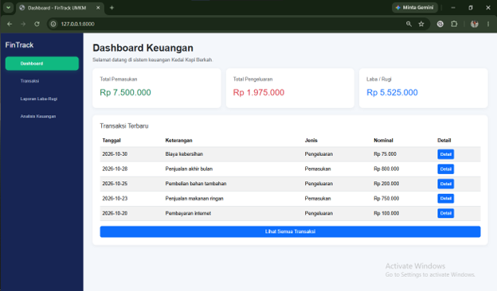
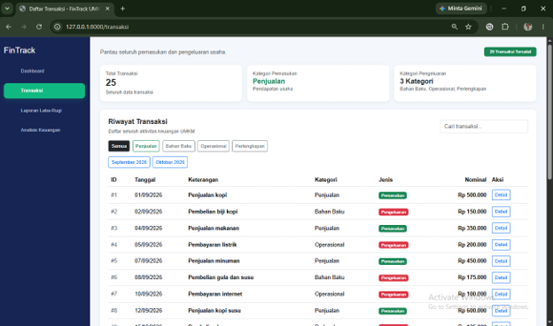
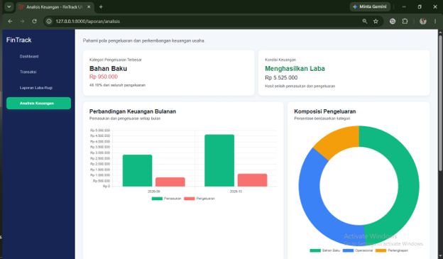
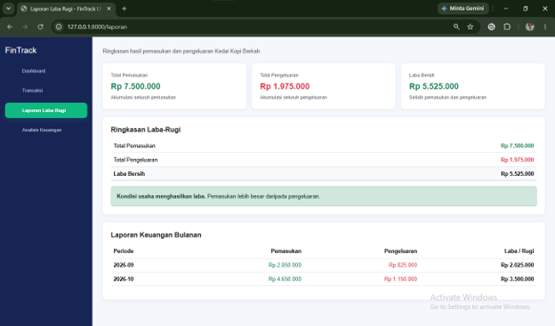

# FinTrack UMKM
### Sistem Analisis Keuangan dan Laporan Laba-Rugi UMKM

## Identitas Mahasiswa

| Keterangan | Identitas |
|---|---|
| Nama Lengkap | ZAHRAN NAUFAL AMAR |
| NIM | C2483207012 |
| Kelas | PTI5 |
| Mata Kuliah | Pemrograman Internet |
| Tahun Akademik | 2026/2027 |

## 1. Deskripsi Proyek

**FinTrack UMKM** merupakan aplikasi berbasis web yang dikembangkan untuk membantu pelaku Usaha Mikro, Kecil, dan Menengah (UMKM) dalam mengelola serta menganalisis kondisi keuangan usaha.

Aplikasi ini dibuat berdasarkan permasalahan pencatatan keuangan UMKM yang sering mengalami kesulitan dalam mengetahui total pemasukan, pengeluaran, keuntungan, kategori pengeluaran terbesar, serta perkembangan keuangan setiap bulan.

Melalui aplikasi ini, pengguna dapat melihat ringkasan keuangan, mengelola informasi transaksi, melihat laporan laba-rugi, dan mengetahui hasil analisis kondisi keuangan usaha.

Studi kasus yang digunakan dalam proyek ini adalah **Kedai Kopi Berkah**.

## 2. Tujuan Aplikasi

Tujuan pengembangan FinTrack UMKM adalah:

- Membantu pencatatan dan pengelolaan transaksi keuangan UMKM.
- Menghitung total pemasukan dan pengeluaran.
- Mengetahui keuntungan atau kerugian usaha.
- Mengelompokkan pengeluaran berdasarkan kategori.
- Mengetahui kategori pengeluaran terbesar.
- Membandingkan kondisi keuangan berdasarkan periode bulanan.
- Menyajikan informasi keuangan melalui dashboard dan grafik.

## 3. Fitur Aplikasi

Aplikasi FinTrack UMKM memiliki beberapa fitur utama:

1. **Dashboard** – Menampilkan ringkasan pemasukan, pengeluaran, laba bersih, dan grafik keuangan.
2. **Daftar Transaksi** – Menampilkan seluruh data pemasukan dan pengeluaran.
3. **Detail Transaksi** – Menampilkan informasi transaksi berdasarkan parameter URL.
4. **Filter Kategori** – Menampilkan transaksi berdasarkan kategori.
5. **Filter Periode** – Menampilkan transaksi berdasarkan bulan atau periode.
6. **Laporan Laba-Rugi** – Menampilkan hasil perhitungan pemasukan, pengeluaran, dan laba bersih.
7. **Analisis Keuangan** – Menampilkan analisis pengeluaran, persentase kategori, dan perbandingan keuangan bulanan.

## 4. Teknologi yang Digunakan

- PHP 8.3
- Laravel
- HTML5
- CSS3
- Bootstrap 5
- Bootstrap Icons
- JavaScript
- Chart.js
- Visual Studio Code
- Git dan GitHub

## 5. Implementasi MVC Laravel

Proyek ini menerapkan konsep Model-View-Controller (MVC) dengan menggunakan Routing, Controller, dan Blade View.

### A. Routing

Routing digunakan untuk mengatur alamat URL dan menghubungkan permintaan pengguna dengan Controller yang sesuai.

### B. Controller

Controller bertanggung jawab untuk mengolah data transaksi dan melakukan perhitungan keuangan, seperti:

- Menghitung total pemasukan.
- Menghitung total pengeluaran.
- Menghitung laba atau rugi.
- Mengelompokkan pengeluaran berdasarkan kategori.
- Menghitung persentase pengeluaran.
- Membandingkan kondisi keuangan bulanan.

### C. Blade View

Blade View digunakan untuk menampilkan hasil pengolahan data kepada pengguna melalui halaman web.

Struktur Blade yang digunakan meliputi `@extends`, `@section`, `@yield`, `@foreach`, dan `@if`.

## 6. Struktur Data dan Pengolahan Keuangan

Aplikasi ini menggunakan data transaksi berbentuk **array PHP** dan tidak menggunakan database.

Data transaksi disimpan dalam file:

`app/Data/DataTransaksi.php`

Jumlah data transaksi yang digunakan adalah 25 transaksi dengan periode September dan Oktober 2026.

### Rumus Perhitungan

**1. Total Pemasukan**

Total seluruh transaksi dengan jenis pemasukan.

**2. Total Pengeluaran**

Total seluruh transaksi dengan jenis pengeluaran.

**3. Laba Bersih**

Laba Bersih = Total Pemasukan - Total Pengeluaran

**4. Persentase Pengeluaran Kategori**

Persentase = (Total Pengeluaran Kategori / Total Pengeluaran) × 100%

**5. Perbandingan Bulanan**

Membandingkan jumlah pemasukan, pengeluaran, dan laba bersih dari setiap bulan.

### Hasil Perhitungan Data

| Keterangan | September 2026 | Oktober 2026 |
|---|---:|---:|
| Pemasukan | Rp2.850.000 | Rp4.650.000 |
| Pengeluaran | Rp825.000 | Rp1.150.000 |
| Laba Bersih | Rp2.025.000 | Rp3.500.000 |

**Ringkasan keseluruhan:**

| Keterangan | Jumlah |
|---|---:|
| Total Pemasukan | Rp7.500.000 |
| Total Pengeluaran | Rp1.975.000 |
| Laba Bersih | Rp5.525.000 |

Kategori pengeluaran terbesar adalah **Bahan Baku** dengan total pengeluaran Rp950.000.

## 7. Screenshot Aplikasi

Screenshot berikut memperlihatkan tampilan aplikasi FinTrack UMKM.

### A. Dashboard



### B. Daftar Transaksi



### C. Analisis Keuangan



### D. Laporan Keuangan




## 8. Cara Menjalankan Aplikasi

Berikut langkah-langkah untuk menjalankan aplikasi FinTrack UMKM di komputer lokal.

### Persyaratan

- PHP 8.3 atau versi yang kompatibel.
- Composer.
- Laravel.
- Laragon atau lingkungan server lokal lainnya.

### Langkah Instalasi

**1. Clone repository**

```bash
git clone https://github.com/USERNAME/fintrack-umkm.git
```

**2. Masuk ke folder project**

```bash
cd fintrack-umkm
```

**3. Instal dependency**

```bash
composer install
```

**4. Salin file konfigurasi**

Windows CMD:

```cmd
copy .env.example .env
```

**5. Generate application key**

```bash
php artisan key:generate
```

**6. Bersihkan cache konfigurasi**

```bash
php artisan optimize:clear
```

**7. Jalankan aplikasi**

```bash
php artisan serve
```

**8. Buka aplikasi melalui browser**

```text
http://127.0.0.1:8000
```

## 9. Ketentuan Pengembangan

- Aplikasi dikembangkan menggunakan Laravel.
- Data transaksi menggunakan array PHP.
- Tidak menggunakan database.
- Perhitungan dan analisis dilakukan di Controller.
- Tampilan menggunakan Blade View.
- Menggunakan parameter URL untuk menampilkan detail transaksi.
- Aplikasi dibuat responsif agar dapat digunakan melalui berbagai ukuran layar.

## 10. Repository GitHub

Source code proyek dapat diakses melalui repository berikut:

**GitHub:** https://github.com/USERNAME/fintrack-umkm

---

**FinTrack UMKM – Sistem Analisis Keuangan dan Laporan Laba-Rugi UMKM**

Dibuat untuk memenuhi tugas Ujian Tengah Semester (UTS) mata kuliah Pemrograman Internet, Program Studi Pendidikan Teknologi Informasi, Universitas Muhammadiyah Tasikmalaya Tahun Akademik 2026/2027.
